# FLOWCHART — SMART HOME IoT SYSTEM

**Project:** Smart Home IoT Monitoring System  
**Version:** 1.0  
**Microcontroller:** ESP32 DevKit V1  
**Firmware:** MicroPython  
**Mobile Application:** Flutter  
**Database:** SQLite  
**Communication:** Wi-Fi + HTTP API

---

## 1. FLOWCHART SISTEM UTAMA

Menggambarkan keseluruhan proses kerja Smart Home dari pembacaan sensor sampai data ditampilkan di aplikasi.

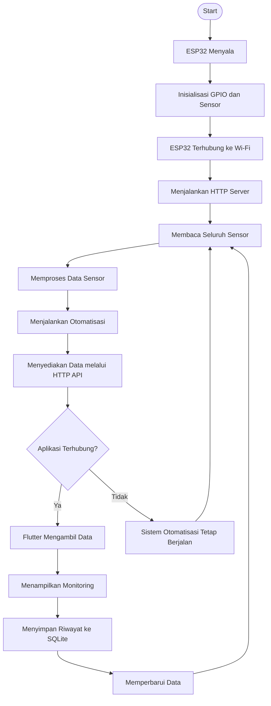

## 2. FLOWCHART INISIALISASI ESP32

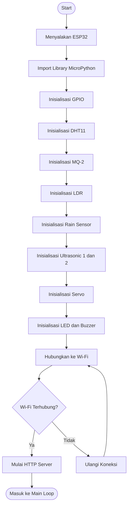

## 3. FLOWCHART RAIN SENSOR DAN SERVO

Fungsi: Ketika sensor hujan mendeteksi air, servo bergerak ke 90°. Ketika tidak ada air, servo kembali ke 0°.

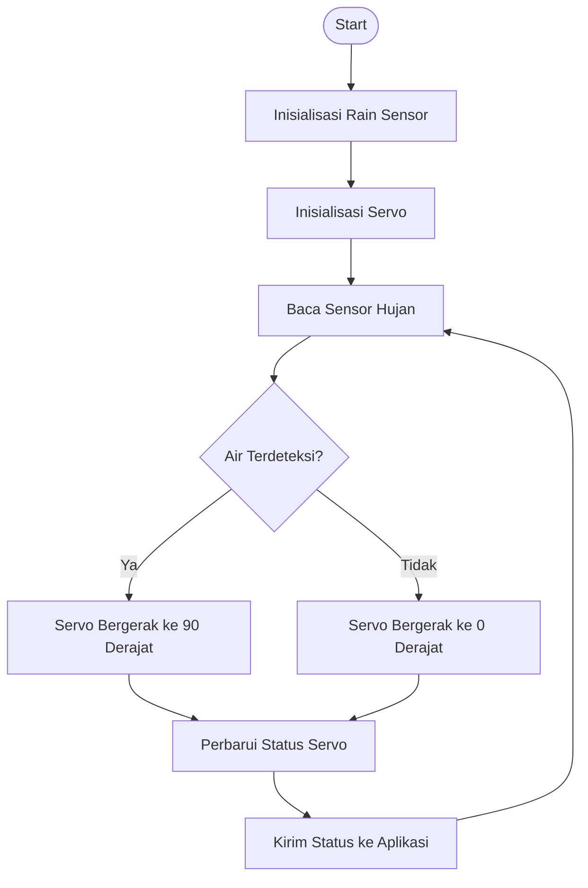

## 4. FLOWCHART DHT11 DAN BUZZER

Fungsi: Membaca suhu dan kelembapan. Jika suhu melewati batas, buzzer akan aktif.

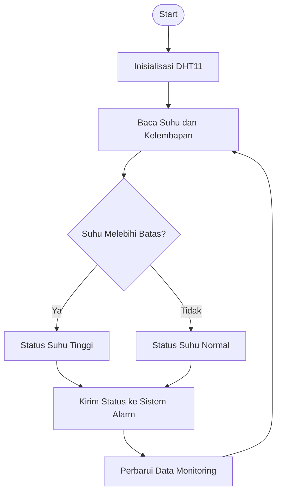

## 5. FLOWCHART MQ-2 DAN BUZZER

Fungsi: Membaca nilai gas/asap dari MQ-2.

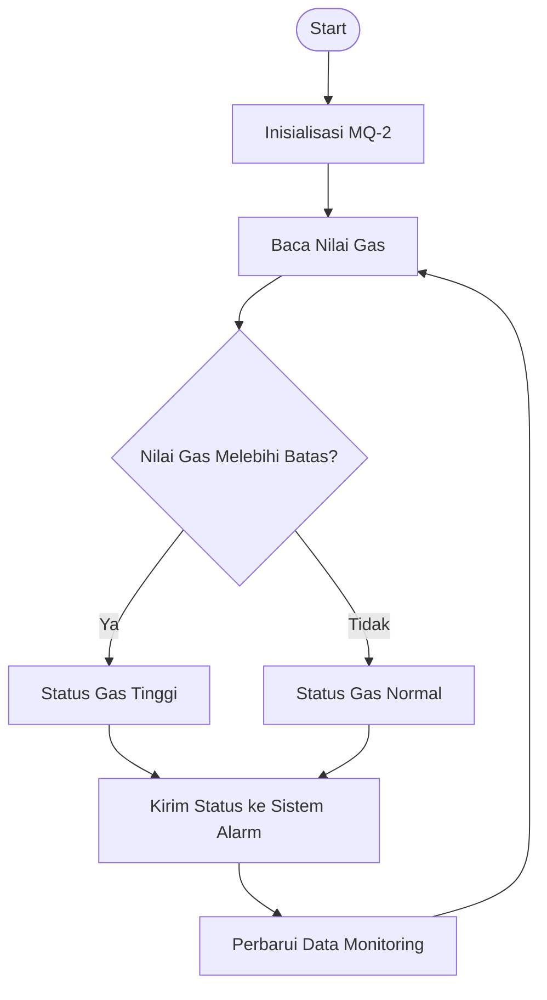

### Logika Gabungan Buzzer

Buzzer dikendalikan berdasarkan dua kondisi sekaligus.

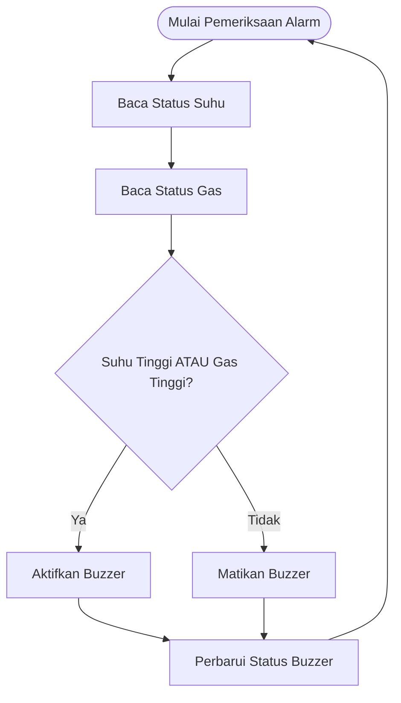

Ketentuan:
- Suhu tinggi menyebabkan buzzer aktif.
- Gas tinggi menyebabkan buzzer aktif.
- Jika keduanya normal, buzzer mati.
- Buzzer tidak mati selama salah satu kondisi masih tinggi.

## 6. FLOWCHART ULTRASONIC 1 — DETEKSI TAMU

Fungsi: Mendeteksi keberadaan tamu di depan rumah dan mengirimkan notifikasi ke aplikasi.

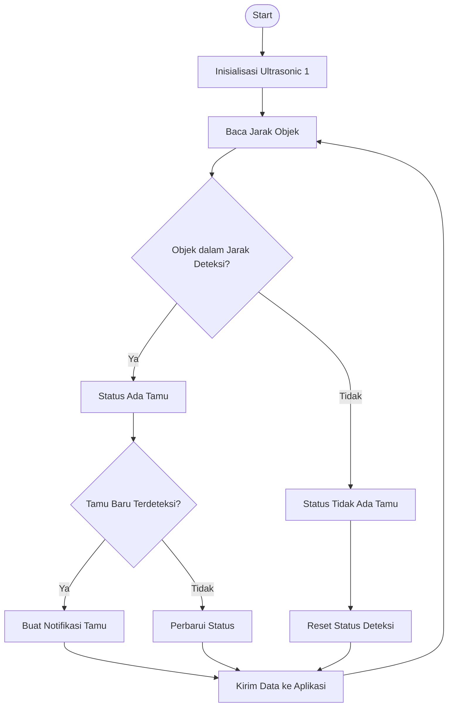

Contoh notifikasi:

"Ada tamu di depan rumah."

Notifikasi hanya dibuat ketika terjadi deteksi baru, bukan setiap kali sensor membaca objek yang sama.

## 7. FLOWCHART ULTRASONIC 2 — MONITORING KENDARAAN

Fungsi: Mendeteksi apakah mobil masih berada di area parkir.

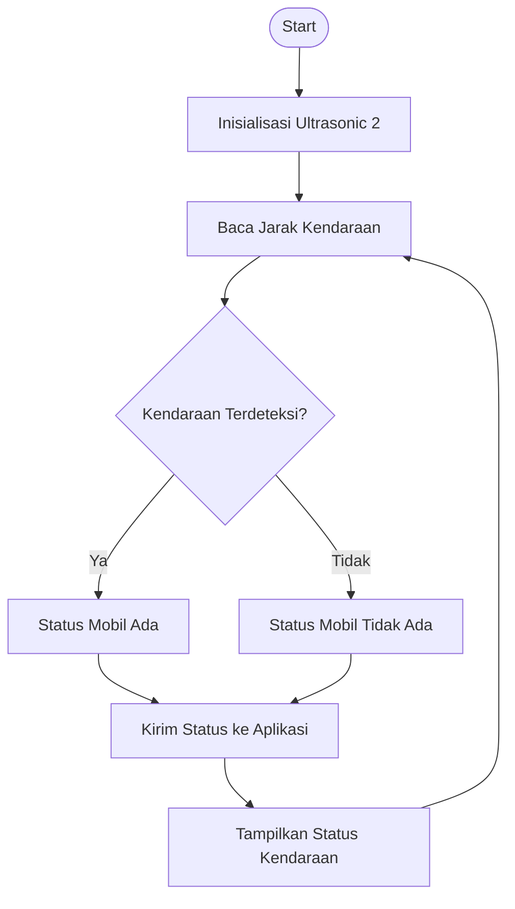

## 8. FLOWCHART LDR DAN LED

Fungsi: Menghidupkan lampu secara otomatis ketika kondisi gelap.

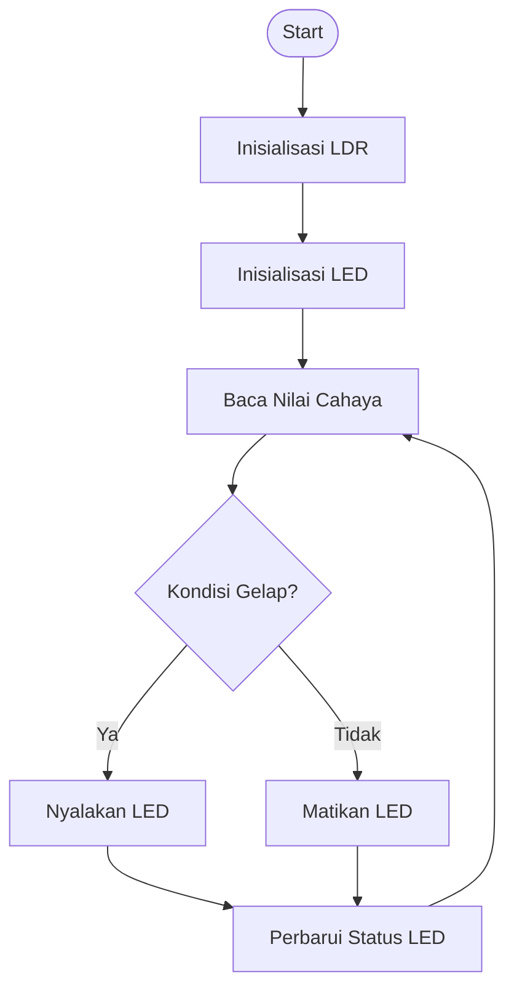

## 9. FLOWCHART KONEKSI APLIKASI DAN ESP32

Fungsi: Menghubungkan aplikasi Flutter dengan ESP32 melalui alamat IP.

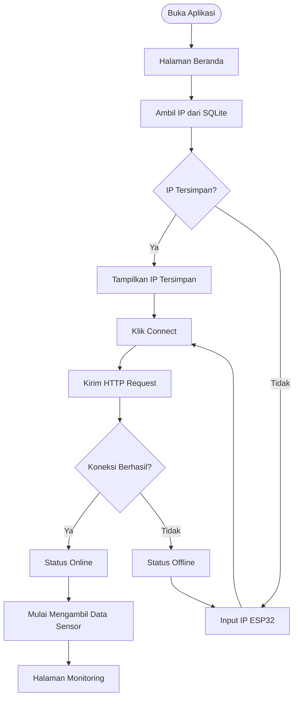

## 10. FLOWCHART PENGAMBILAN DATA SENSOR

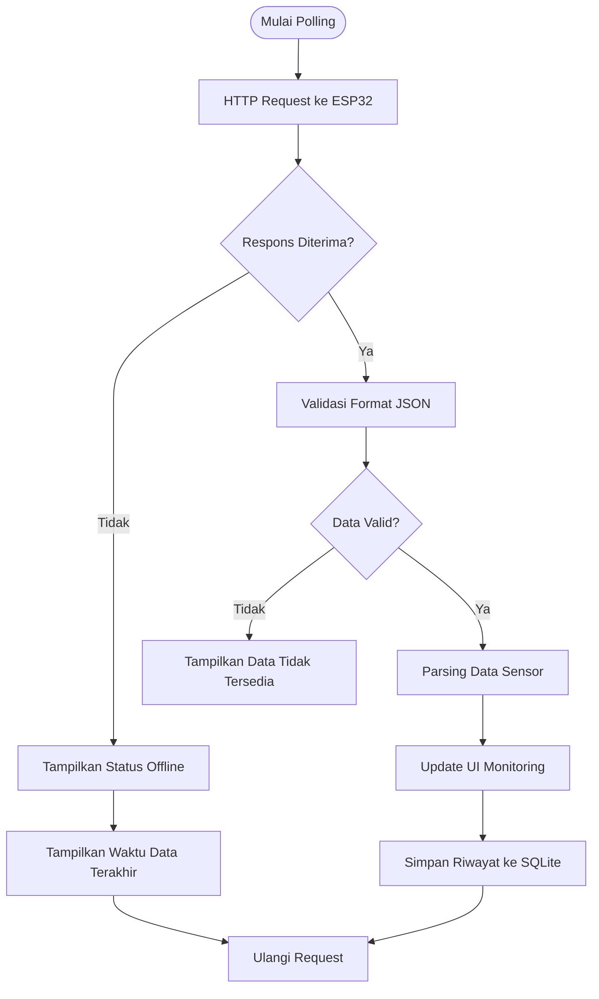

## 11. FLOWCHART DATABASE SQLITE

Fungsi: Menyimpan data monitoring dan riwayat notifikasi secara lokal.

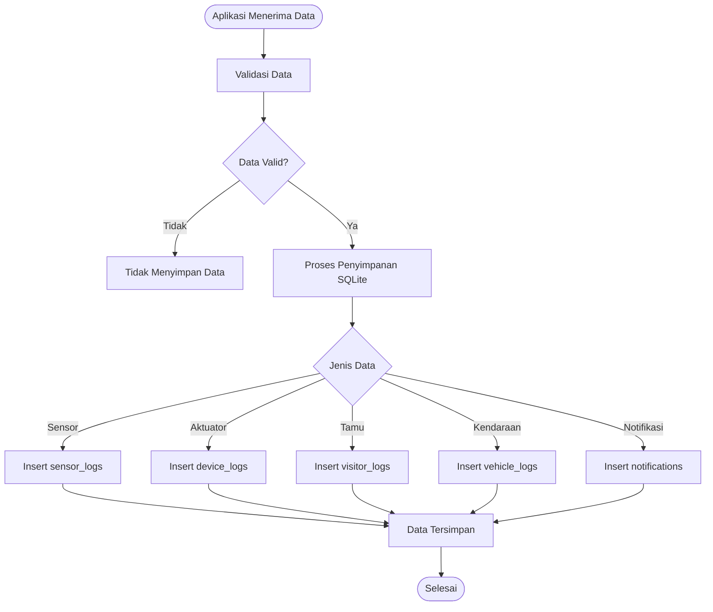

## 12. FLOWCHART NAVIGASI APLIKASI

Aplikasi hanya memiliki dua halaman utama.

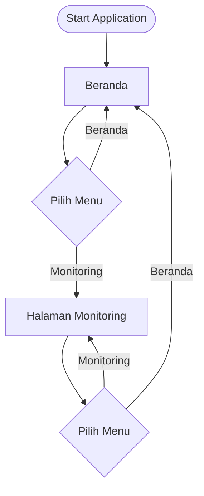

### Halaman Beranda
- Informasi umum Smart Home.
- Input IP ESP32.
- Tombol Connect dan Disconnect.
- Status koneksi.
- Ringkasan suhu.
- Ringkasan kelembapan.
- Ringkasan gas.
- Ringkasan cahaya.

### Halaman Monitoring
- Data seluruh sensor.
- Status servo.
- Status LED.
- Status buzzer.
- Deteksi tamu.
- Status kendaraan.
- Riwayat notifikasi.

## 13. FLOWCHART KESELURUHAN OTOMATISASI

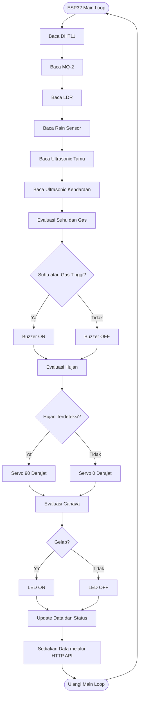

---

## 14. CATATAN IMPLEMENTASI

1. Semua otomatisasi utama dijalankan langsung oleh ESP32.
2. Flutter bertugas menampilkan data dan riwayat monitoring.
3. SQLite digunakan sebagai database lokal aplikasi.
4. Koneksi aplikasi menggunakan IP ESP32 pada jaringan Wi-Fi yang sama.
5. Setiap sensor harus diuji secara terpisah sebelum digabungkan.
6. Ambang batas suhu, gas, jarak tamu, dan jarak kendaraan harus ditentukan berdasarkan pengujian.
7. Gunakan pembacaan sensor yang memiliki timeout agar satu sensor yang bermasalah tidak menghentikan seluruh sistem.
8. Data monitoring harus memiliki timestamp.
9. Status Offline harus ditampilkan jika komunikasi gagal.
10. Sistem otomatisasi tetap berjalan meskipun aplikasi mobile ditutup.

---

**END OF DOCUMENT**

Project: Smart Home IoT Monitoring System  
Document: flowchart.md  
Version: 1.0