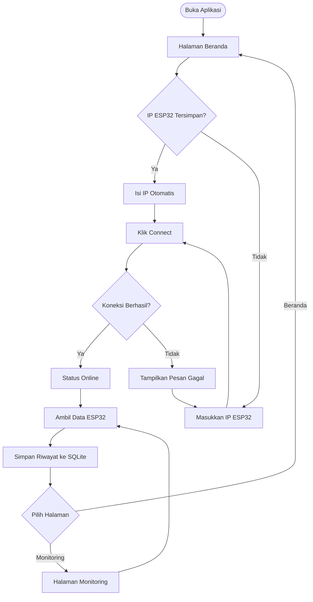
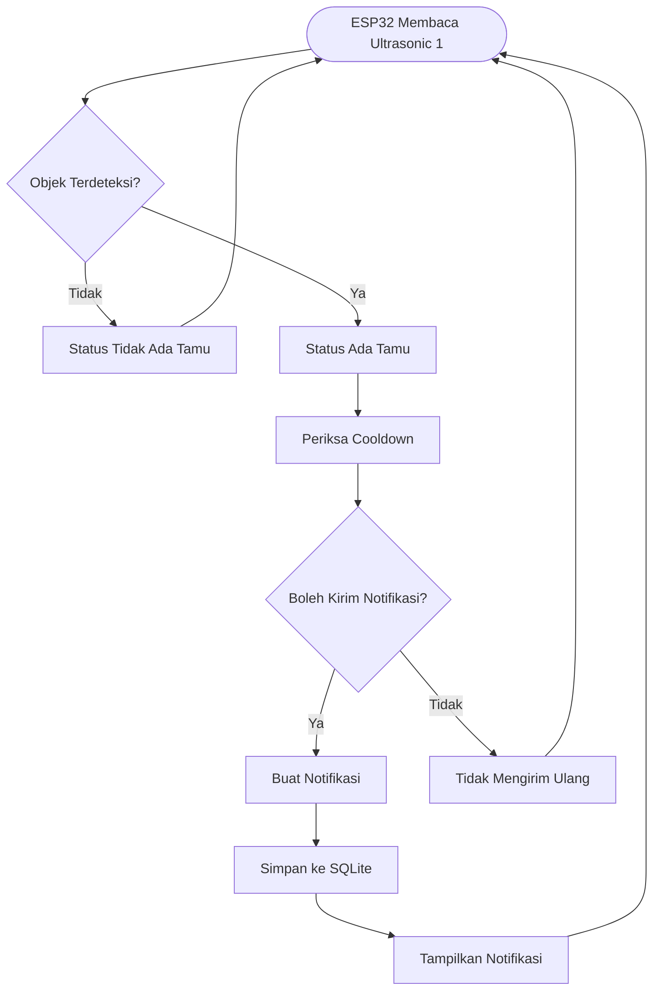
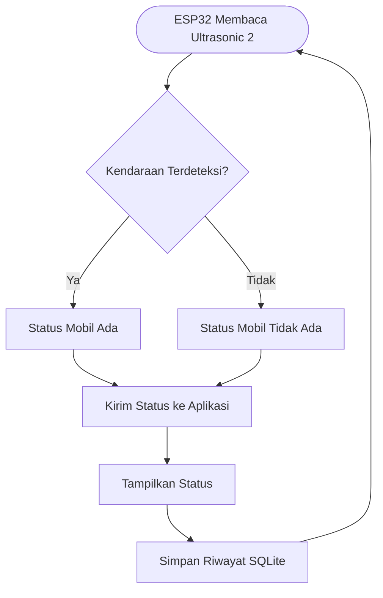
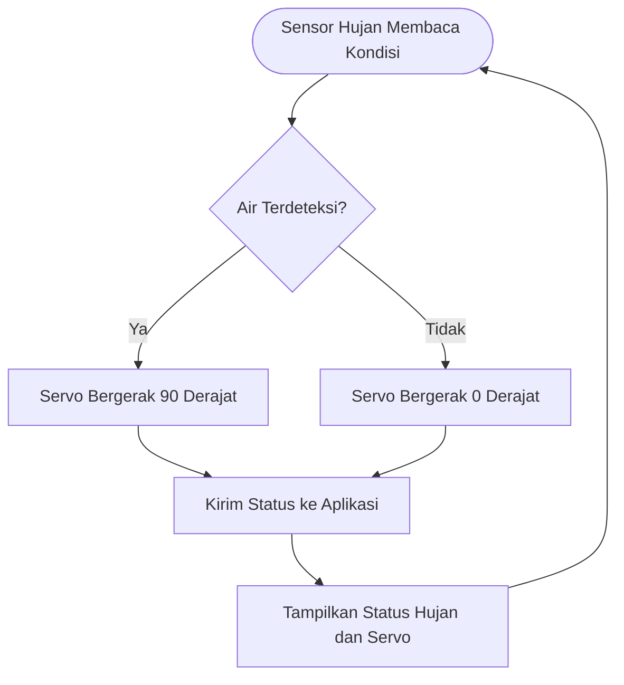
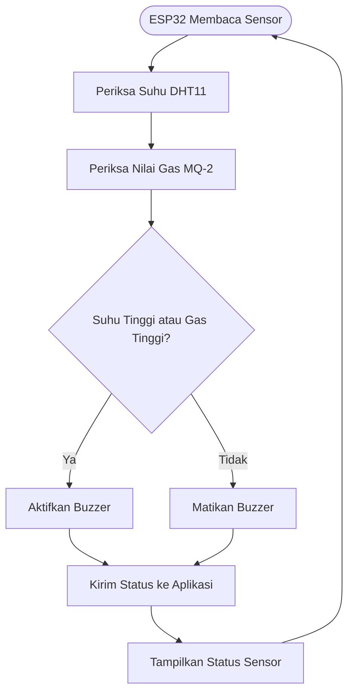
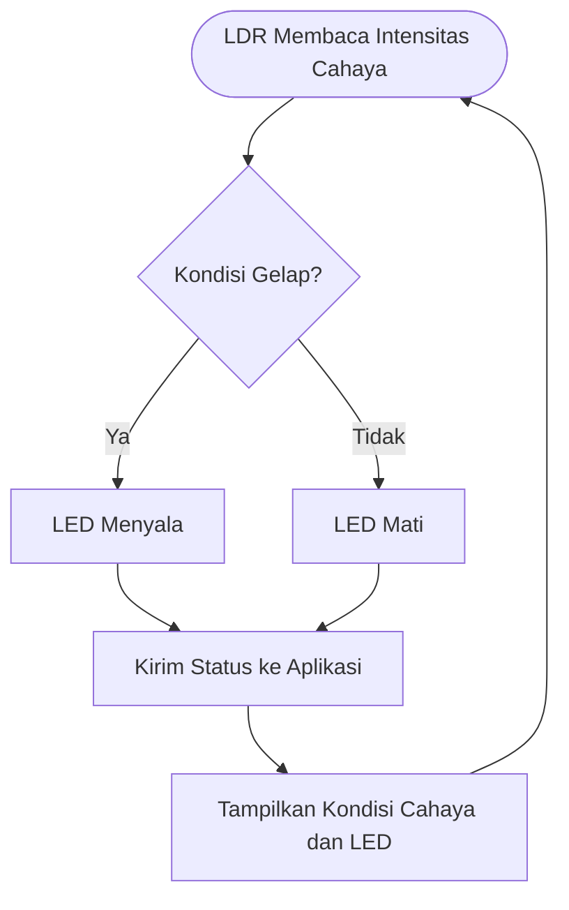
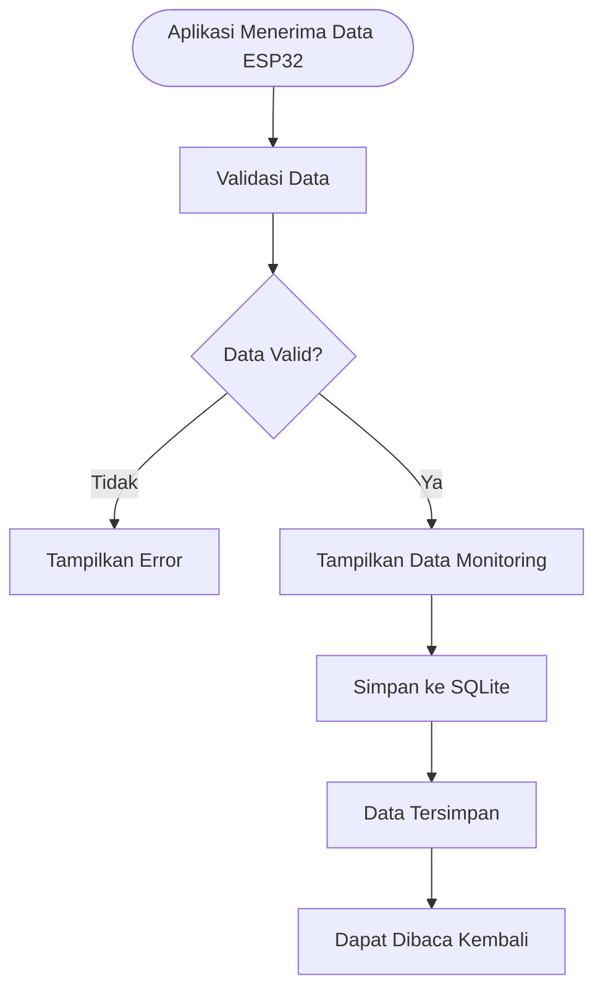
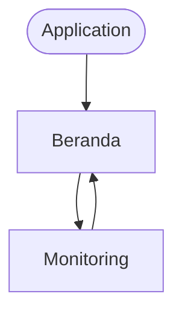

# USER FLOW — SMART HOME APPLICATION

**Project:** Smart Home IoT Monitoring System  
**Version:** 1.0  
**Platform:** Android Mobile Application  
**Framework:** Flutter  
**Database:** SQLite  
**Communication:** Wi-Fi + HTTP API

---

## 1. OVERVIEW

User Flow ini menjelaskan alur interaksi pengguna ketika menggunakan aplikasi Smart Home.

Aplikasi memiliki dua halaman utama:
1. Beranda
2. Monitoring

Pengguna harus menghubungkan aplikasi dengan ESP32 menggunakan alamat IP sebelum dapat melihat data monitoring secara langsung.

## 2. MAIN APPLICATION FLOW

## 3. USER FLOW — BERANDA

Beranda merupakan halaman pertama yang dibuka pengguna.

### Alur Pengguna

1. Pengguna membuka aplikasi.
2. Aplikasi menampilkan halaman Beranda.
3. Aplikasi memeriksa IP ESP32 yang tersimpan di SQLite.
4. Jika IP tersedia, input IP diisi otomatis.
5. Jika IP belum tersedia, pengguna memasukkan IP secara manual.
6. Pengguna menekan tombol Connect.
7. Aplikasi mengirim HTTP request ke ESP32.
8. Aplikasi memeriksa hasil koneksi.

### Kondisi Koneksi

**Jika berhasil:**
- Status koneksi berubah menjadi Online.
- Aplikasi mulai mengambil data sensor.
- IP disimpan ke SQLite.
- Ringkasan monitoring ditampilkan.

**Jika gagal:**
- Status koneksi berubah menjadi Offline.
- Aplikasi menampilkan pesan koneksi gagal.
- Pengguna dapat mencoba menghubungkan kembali.

### Beranda — Informasi yang Ditampilkan

- Status koneksi ESP32.
- Input IP ESP32.
- Tombol Connect dan Disconnect.
- Suhu DHT11.
- Kelembapan DHT11.
- Nilai gas MQ-2.
- Kondisi cahaya LDR.
- Ringkasan kondisi rumah.
- Navigasi ke Monitoring.

## 4. USER FLOW — MONITORING

Halaman Monitoring digunakan untuk melihat seluruh informasi sensor dan aktuator.

### Alur Pengguna

1. Pengguna memilih menu Monitoring.
2. Aplikasi memeriksa status koneksi ESP32.
3. Jika Online, aplikasi mengambil data sensor.
4. Data ditampilkan berdasarkan kategori.
5. Data monitoring disimpan ke SQLite.
6. Aplikasi memperbarui data secara berkala.

Jika Offline:
- Tampilkan indikator Offline.
- Tampilkan informasi waktu pembaruan terakhir.
- Jangan menganggap data lama sebagai data terbaru.
- Pengguna dapat kembali ke Beranda untuk memperbaiki koneksi.

### Monitoring Categories

**A. Environmental Monitoring**
- Suhu.
- Kelembapan.
- Nilai gas.
- Intensitas cahaya.

**B. Security Monitoring**
- Deteksi tamu.
- Jarak tamu.
- Status kendaraan.
- Jarak kendaraan.

**C. Automatic Control**
- Status hujan.
- Posisi servo.
- Status LED.
- Status buzzer.

**D. Notification History**
- Notifikasi tamu.
- Peringatan suhu tinggi.
- Peringatan gas tinggi.
- Waktu notifikasi.
- Status sudah dibaca atau belum.

## 5. USER FLOW — VISITOR DETECTION

Fitur ini menggunakan Ultrasonic 1.

### Hasil yang Diharapkan

Ketika tamu terdeteksi:
- Aplikasi menerima informasi deteksi.
- Notifikasi ditampilkan.
- Riwayat notifikasi disimpan.

Contoh notifikasi:

**Ada tamu di depan rumah.**

Notifikasi tidak dikirim berulang kali selama orang masih berada di area deteksi.

## 6. USER FLOW — VEHICLE MONITORING

Fitur ini menggunakan Ultrasonic 2.

### Status Aplikasi

| Kondisi | Status |
|---|---|
| Kendaraan terdeteksi | Mobil Ada |
| Kendaraan tidak terdeteksi | Mobil Tidak Ada |

Status diperbarui secara otomatis berdasarkan pembacaan sensor.

## 7. USER FLOW — RAIN SENSOR & SERVO

Fitur otomatisasi hujan berjalan langsung pada ESP32.

### Kondisi

| Kondisi | Servo |
|---|---|
| Hujan terdeteksi | 90° |
| Tidak ada hujan | 0° |

Aplikasi hanya menampilkan status otomatisasi tersebut.

## 8. USER FLOW — TEMPERATURE & GAS ALERT

Fitur ini menggunakan DHT11, MQ-2, dan buzzer.

### Ketentuan

- Suhu melewati ambang batas: buzzer aktif.
- Gas melewati ambang batas: buzzer aktif.
- Salah satu kondisi masih tinggi: buzzer tetap aktif.
- Kedua kondisi normal: buzzer mati.

Nilai ambang batas ditentukan melalui pengujian sensor.

## 9. USER FLOW — LDR & LED

Fitur otomatisasi pencahayaan berjalan langsung di ESP32.

| Kondisi | LED |
|---|---|
| Gelap | ON |
| Terang | OFF |

## 10. USER FLOW — SQLITE DATABASE

SQLite digunakan sebagai database lokal aplikasi.

### Data yang Disimpan

| Aktivitas | Penyimpanan |
|---|---|
| IP ESP32 | connection_settings |
| Pembacaan sensor | sensor_logs |
| Status aktuator | device_logs |
| Deteksi tamu | visitor_logs |
| Status kendaraan | vehicle_logs |
| Notifikasi | notifications |

### Database Flow

Database tetap menyimpan riwayat lokal meskipun aplikasi ditutup.

## 11. ERROR HANDLING FLOW

### A. ESP32 Tidak Terhubung

- Pengguna memasukkan IP.
- Aplikasi mencoba koneksi.
- Request mengalami kegagalan.
- Status menjadi Offline.
- Aplikasi menampilkan pesan kesalahan.
- Pengguna dapat mencoba kembali.

### B. Data Sensor Tidak Tersedia

- Aplikasi menerima respons tidak lengkap.
- Parameter yang tidak tersedia ditandai sebagai Unavailable.
- Data lama tidak dianggap sebagai pembacaan terbaru.
- Sistem tetap menampilkan parameter lain yang berhasil diterima.

### C. Koneksi Terputus

- Aplikasi mendeteksi request gagal.
- Status berubah menjadi Offline.
- Waktu pembaruan terakhir ditampilkan.
- Aplikasi mencoba menghubungkan kembali sesuai mekanisme retry.

## 12. APPLICATION NAVIGATION

Tidak ada halaman utama tambahan.

Pengguna hanya dapat berpindah antara:
- Beranda
- Monitoring

## 13. FINAL USER JOURNEY

Alur utama penggunaan aplikasi:

1. Pengguna membuka aplikasi.
2. Pengguna memasukkan IP ESP32.
3. Aplikasi berhasil terhubung.
4. Pengguna melihat ringkasan kondisi rumah di Beranda.
5. Pengguna membuka Monitoring.
6. Pengguna memantau seluruh sensor dan aktuator.
7. Aplikasi menerima pembaruan data secara berkala.
8. Riwayat monitoring dan notifikasi tersimpan di SQLite.
9. Sistem otomatisasi tetap berjalan pada ESP32 tanpa harus membuka aplikasi.

---

**END OF DOCUMENT**

Project: Smart Home IoT Monitoring System  
Document: userflow.md  
Version: 1.0